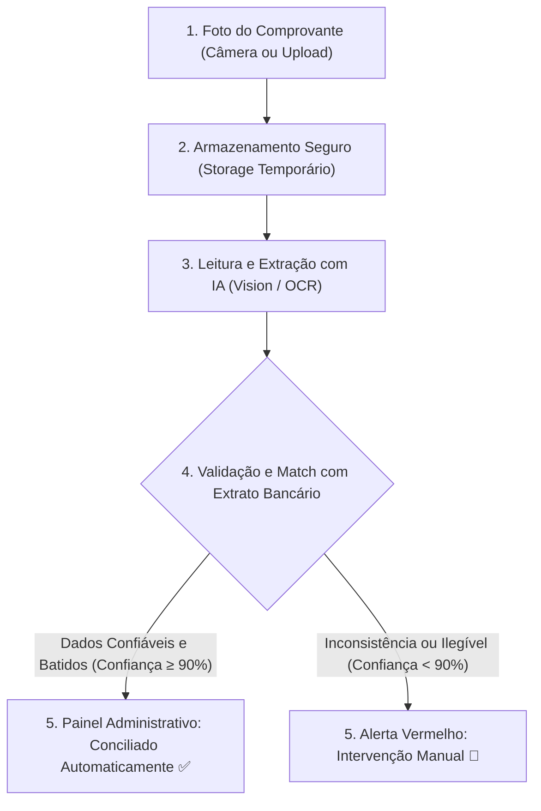
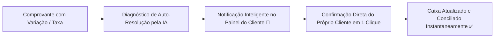
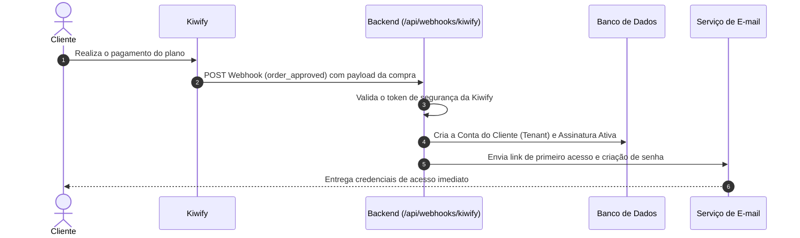

# 🏛️ Arquitetura do Sistema - BPO Financeiro e Auxiliar Administrativo Automatizado

## 1. Escopo e Visão Geral
Micro-SaaS com inteligência artificial projetado para microempresas (MEI e ME) executarem a gestão de comprovantes, fluxo de caixa e conciliação bancária de forma quase 100% autônoma, demandando intervenção humana exclusivamente em caso de inconsistências.

O sistema é dividido em três diretórios principais:
* **`/docs`**: Especificações de negócio, arquitetura técnica e contratos de API.
* **`/frontend`**: Aplicação híbrida (Web / PWA Mobile) construída com **Next.js** e **Tailwind CSS**.
* **`/backend`**: Motor em Python/Node.js responsável pelas integrações com IA (LLM/Vision/OCR), regras de conciliação bancária, persistência de dados e webhooks.

---

## 2. Pipeline de Processamento de IA

### Detalhamento do Fluxo:
1. **Entrada do Comprovante:** O microempresário tira uma foto pelo celular ou sobe um arquivo (PDF, PNG, JPG) de recibo, cupom fiscal, boleto pago ou comprovante Pix.
2. **Camada de Leitura OCR/IA Multimodal:**
   * A imagem é processada por modelo de visão (ex.: GPT-4o-mini / Gemini Flash) com prompt estrito de extração JSON.
   * **Campos extraídos:** Data da transação, Valor total (R$), Nome e CNPJ/CPF do favorecido/pagador, Tipo de transação (Pix, Boleto, Cartão, TED) e Categoria sugerida (ex.: Fornecedor, Alimentação, Pró-labore).
   * **Score de Confiança:** Cada extração recebe uma pontuação de certeza de 0.00 a 1.00.
3. **Cruzamento com o Extrato (Conciliação):**
   * O sistema busca no extrato bancário do dia (D-1 até D+2) um lançamento com valor idêntico e mesma direção (entrada/saída).
4. **Alimentação do Painel Administrativo:**
   * Se os dados baterem 100%, o lançamento é registrado diretamente no fluxo de caixa e o status muda para `CONCILIADO`.

---

## 3. Fluxo de Auto-Resolução & Confirmação Direta do Cliente

No modelo **Micro-OaaS 100% Autônomo**, **não existe fila de suporte humano interno nem operadores manuais**. O fundador/administrador foca exclusivamente em vendas e marketing.

Quando a IA detecta alguma discrepância (ex.: variação de tarifa bancária ou imagem cortada), ela auto-formula a sugestão e envia uma notificação inteligente para que o **próprio cliente confirme em 1 clique na tela dele**, preservando o sigilo total dos dados.

### Gatilhos e Auto-Resolução:
* **Variação de Valor / Tarifa:** A IA detecta a diferença (ex.: taxa de boleto de R$ 6,50) e sugere a compensação automática para o cliente validar com 1 toque.
* **Documento Cortado:** A IA solicita ao cliente o reenvio ou confirmação direta dos dígitos faltantes.
* **Sem Intermediação:** Zero filas de tickets de suporte, zero operadores humanos visualizando extratos e documentos.

---

## 4. Requisitos de Integração com a Kiwify

A venda do Micro-SaaS será realizada via Kiwify. O ciclo de vida do cliente e seu acesso são 100% automatizados através de Webhooks.

### 4.1 Eventos Obrigatórios do Webhook da Kiwify:
1. **`order_approved` / `subscription_created`:**
   * **Ação:** Cria a organização (`Tenant`), o usuário administrador com o e-mail do comprador, ativa o plano e libera a cota de processamento.
2. **`subscription_renewed`:**
   * **Ação:** Renova o ciclo de faturamento e reseta a cota mensal de comprovantes.
3. **`order_refunded` / `chargeback` / `subscription_canceled`:**
   * **Ação:** Altera o status da assinatura para `BLOQUEADO`. Ao tentar logar, o frontend exibe mensagem informativa com link de renovação na Kiwify.

### 4.2 Requisitos de Segurança do Webhook:
* **Validação de Assinatura/Token:** O endpoint deve rejeitar requisições sem o token secreto configurado na Kiwify (`x-kiwify-signature` ou query param secret).
* **Idempotência:** Garantir que o mesmo evento (`order_id`) processado duas vezes não duplique contas ou resetes indevidos.
* **Isolamento de Dados (Multi-tenancy):** Cada cliente Kiwify só visualiza seus próprios dados bancários e comprovantes.
