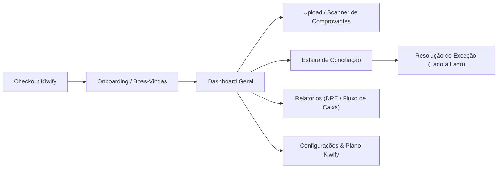

# 📱 Fluxo de Telas - Aplicativo Híbrido BPO Financeiro

## 1. Mapa de Telas

---

## 2. Detalhamento das Telas

### Tela 1: Boas-Vindas & Configuração Rápida (Onboarding)
* **Objetivo:** Primeiro acesso após aprovação na Kiwify.
* **Componentes:**
  * Definição do nome da empresa e CNPJ/CPF.
  * Cadastro das contas bancárias utilizadas (ex.: Itaú, Nubank, Inter).
  * Upload do extrato bancário inicial (OFX ou CSV) ou saldo de abertura.

### Tela 2: Dashboard Geral (Visão 360° do Caixa)
* **Objetivo:** Dar clareza financeira imediata ao microempresário em menos de 10 segundos.
* **Componentes:**
  * Card de Saldo Consolidado Real vs Projetado.
  * Card de **"Status da Automação"**: Ex.: *84% conciliado automaticamente pela IA*.
  * Botão de Ação Rápida Flutuante: **"Escanear Comprovante"** (abre a câmera no celular).
  * Banner de Alerta: Ex.: *2 comprovantes precisam de confirmação*.

### Tela 3: Upload & Scanner de Comprovantes (Híbrido / Mobile First)
* **Objetivo:** Enviar recibos, cupons fiscais e boletos com fricção zero.
* **Componentes:**
  * Botão de captura direta via câmera ou seleção de arquivos (PDF, PNG, JPG).
  * Status visual em tempo real: *"Lendo comprovante com IA..."* ➔ *"Identificado: R$ 150,00 - Padaria São José"*.

### Tela 4: Esteira de Conciliação & Exceções (Core do BPO)
* **Objetivo:** Gerenciar o que a IA conciliou e resolver pendências.
* **Abas:**
  * **Aba 1: Pendentes de Revisão (Exceções):**
    * Exibe visualização lado a lado: Imagem do comprovante de um lado e opções de lançamento do extrato do outro.
    * Ações rápidas: `[Confirmar Match]`, `[Ajustar Categoria/Valor]`, `[Ignorar]`.
  * **Aba 2: Conciliados Automaticamente:**
    * Lista de transações resolvidas pela IA com selo verde `[100% IA]`.

### Tela 5: Relatórios & Fechamento Mensal
* **Objetivo:** Entregar os dados prontos para a gestão da microempresa e para o contador.
* **Componentes:**
  * DRE simplificado (Receitas, Custos, Despesas Operacionais, Lucro Líquido).
  * Botão "Exportar Pacote para Contabilidade" (Gera ZIP com relatórios e comprovantes organizados por mês).
